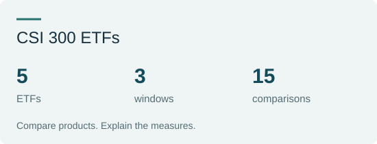
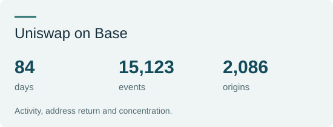

# Xi Wang

**Statistics · Geography · Environmental and Ecological Modelling**

## About

I hold a bachelor's degree in Statistics and am pursuing a master's degree in Resources and Environment at Yunnan University. My research and learning connect **statistics, geography and ecology**. I work with existing observations and public data, using statistical comparisons, numerical analysis and ecological models to study hydrological and ecosystem change.

I am also interested in applying quantitative methods to financial and business questions, bringing careful data checks, model comparisons and clear interpretation into practical decision-making.

## Education

<table>
<tr><td width="86" align="center"></td><td><strong>Yunnan University</strong> Master's student in Resources and Environment Sep 2026—Present</td></tr>
<tr><td width="86" align="center"></td><td><strong>Guangzhou University</strong> BSc in Statistics Sep 2022—Jun 2026</td></tr>
</table>

## Research

**Isotope hydrology · Current research**  
Numerical analysis of precipitation stable isotopes and their meteorological context. My work includes aligning sampling intervals with rainfall and weather data, comparing models on the same records, external evaluation and uncertainty analysis. My current question is whether antecedent weather adds information beyond conditions during the sampling interval.

**Marine food webs and ecosystem modelling · Previous and continuing work**  
Ecopath / Ecosim studies of functional-group relationships, trophic flows and ecosystem dynamics. The work covers cross-model group harmonisation, flow comparisons, sensitivity analysis and dynamic simulations under fisheries and environmental change, with attention to how model assumptions shape ecological interpretation.

## Interests and Methods

**Financial analysis · Numerical analysis · Business analytics · Ecological modelling**

Tools and methods include Python, R, SQL, statistical modelling, model evaluation, time-series analysis, data visualisation and Ecopath / Ecosim. I value reproducible calculations, explicit metric definitions and conclusions supported by evidence.

## Applied Projects

<table>
<tr><td><strong><a href="https://github.com/xiwang-geo/csi300-etf-analysis">CSI 300 ETF Comparison and Fund Screening</a></strong> Compare fees, returns, risk and tracking across five ETFs and three predefined windows, then translate the analysis into a screening and comparison tool. <a href="https://xiwang-geo.github.io/case-etf-en.html">Case overview</a> · <a href="https://github.com/xiwang-geo/csi300-etf-analysis">Code and report</a></td><td width="210"></td></tr>
<tr><td><strong><a href="https://github.com/xiwang-geo/uniswap-base-analysis">Uniswap Activity, Address Return and Concentration</a></strong> Analyse activity trends, first-observed cohorts and concentration from real on-chain events in a single Base pool. Addresses serve as participant proxies. <a href="https://xiwang-geo.github.io/case-uniswap-en.html">Case overview</a> · <a href="https://github.com/xiwang-geo/uniswap-base-analysis">Code and report</a></td><td width="210"></td></tr>
</table>

Contact: [xiwang.geo@outlook.com](mailto:xiwang.geo@outlook.com) · UTC+8

[中文](README.zh-CN.md)
