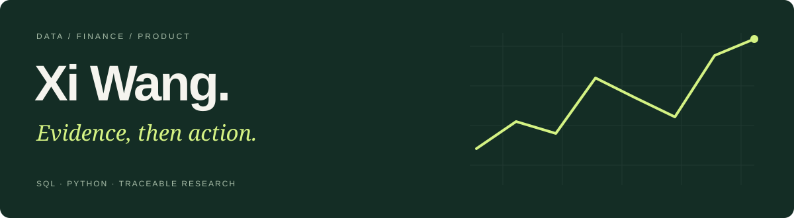

# Xi Wang｜数据与产品分析

[English](README.en.md) · **简体中文** · [作品集网站](https://xiwang-geo.github.io/) · [联系邮箱](mailto:xiwang.geo@outlook.com)

## 关于我

广州大学统计学本科，云南大学资源与环境硕士在读。关注数据分析、金融产品与产品分析，寻求远程实习机会，时区UTC+8。

我的项目从业务问题出发，通过来源核查、指标定义、SQL/Python计算和可复算材料，把观察结果转成有边界的建议。

## 精选项目

### 沪深300ETF产品比较与基金筛选工具优化

比较五只同指数ETF的三个预设窗口，形成15个产品窗口结果。核查分红、费用、共同日期和报价精度，比较收益风险、跟踪表现与交易活跃度，再实现可离线打开的筛选与并列比较工具。

市场比较与原型功能已完成，真实用户效果尚未验证。

[中文案例](https://xiwang-geo.github.io/case-etf.html) · [英文案例](https://xiwang-geo.github.io/case-etf-en.html) · [项目仓库与复算](https://github.com/xiwang-geo/csi300-etf-analysis)

### Base链Uniswap单池活动、地址回访与集中度分析

以84天、15,123条交换事件及2,086个交易发起地址为基础，完成活动构成、首次观察地址回访、集中度和两套头部剔除敏感性分析，形成运营监测建议与交互看板。

地址不等同真实用户，单池缺席不等同协议流失，算术拆解不等同营销归因。

[中文案例](https://xiwang-geo.github.io/case-uniswap.html) · [英文案例](https://xiwang-geo.github.io/case-uniswap-en.html) · [项目仓库与复算](https://github.com/xiwang-geo/uniswap-base-analysis)

## 项目工具与方法

SQL、Python、SQLite、数据质量核查、队列分析、金融产品比较、产品评估设计。

两个案例均提供报告、交互工具、SQL、数据与可复算文件。原报告与工具使用中文，案例网页与项目说明提供中英文版本。

## 联系

[xiwang.geo@outlook.com](mailto:xiwang.geo@outlook.com) · UTC+8
