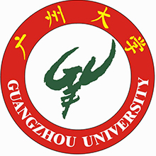
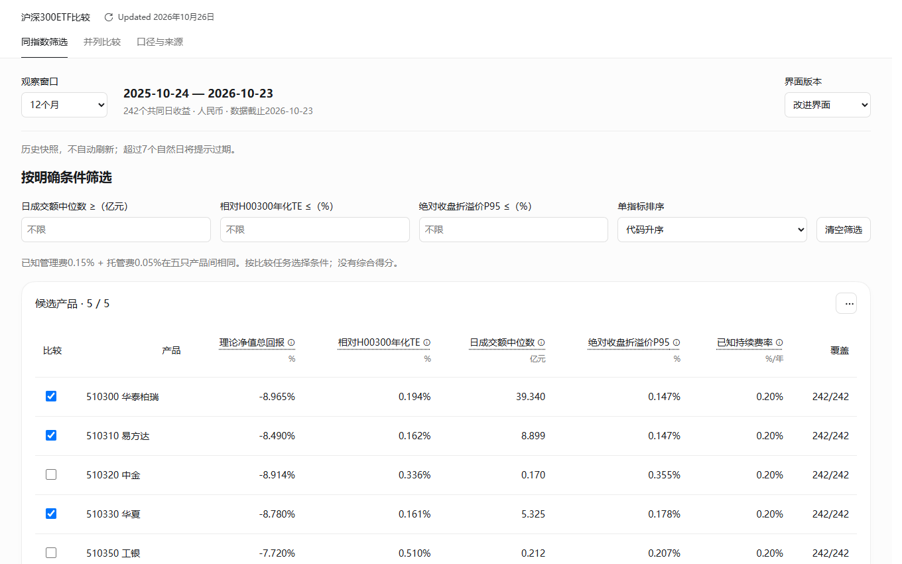

<a href="#中文">中文</a> · <a href="#english">English</a> · <a href="mailto:xiwang.geo@outlook.com">联系我</a>

## 关于我

我是王曦，统计学本科毕业，目前在云南大学攻读资源与环境硕士。我的研究与学习连接**统计学、地理学与生态学**：从已有观测和公开数据出发，运用统计比较、数值分析与生态模型，研究水文和生态系统中的变化。

我也关注定量方法在金融与商业问题中的应用，希望把研究中的数据核查、模型比较和结果解释，带到具体的分析与决策中。

## 教育背景

<table>
<tr><td width="86" align="center"></td><td><strong>云南大学</strong> 资源与环境 · 硕士研究生在读 2026.09—至今</td></tr>
<tr><td width="86" align="center"></td><td><strong>广州大学</strong> 统计学 · 理学学士 2022.09—2026.06</td></tr>
</table>

## 研究经历与当前方向

**水同位素水文学 · 当前研究**  
围绕降水稳定同位素及其天气背景开展数值分析。整理采样时间、降水与气象资料，通过同一记录上的模型比较、外部检验与不确定性分析，评估不同解释变量提供的信息；目前关注采样前天气能否在采样期间天气之外增加解释能力。

**海洋食物网与生态系统建模 · 既往及延续工作**  
使用 Ecopath / Ecosim 分析功能群关系、营养流与生态系统动态。研究涉及跨模型功能群映射、通量比较、敏感性分析，以及渔业和环境变化下的动态模拟，关注模型假设如何影响生态解释。

## 研究与应用兴趣

**金融分析 · 数值分析 · 商业分析 · 生态领域建模**

常用方法与工具：Python、R、SQL，统计建模、模型检验、时间序列分析、数据可视化，以及 Ecopath / Ecosim。重视可复算的分析过程、明确的指标口径与有依据的结论。

## 应用项目

<table>
<tr><td><strong><a href="https://github.com/xiwang-geo/csi300-etf-analysis">沪深300ETF产品比较与基金筛选工具优化</a></strong> 比较五只同指数ETF在三个预设窗口中的费用、收益、风险及跟踪表现，并将结果转为产品筛选与比较工具。 <a href="https://xiwang-geo.github.io/case-etf.html">案例概览</a> · <a href="https://github.com/xiwang-geo/csi300-etf-analysis">代码与报告</a></td><td width="210"></td></tr>
<tr><td><strong><a href="https://github.com/xiwang-geo/uniswap-base-analysis">Base链Uniswap单池活动、地址回访与集中度分析</a></strong> 基于真实链上事件构建活动趋势、首次观察队列与集中度分析；研究范围限定为单池，地址作为参与者代理。 <a href="https://xiwang-geo.github.io/case-uniswap.html">案例概览</a> · <a href="https://github.com/xiwang-geo/uniswap-base-analysis">代码与报告</a></td><td width="210"></td></tr>
</table>

联系：[xiwang.geo@outlook.com](mailto:xiwang.geo@outlook.com) · 时区 UTC+8

[English](README.en.md)
